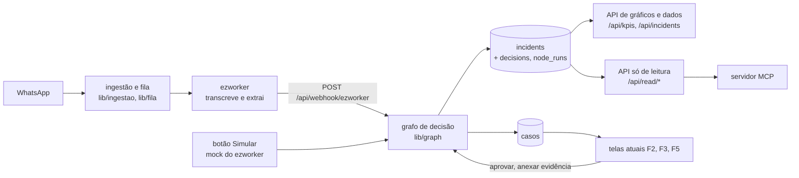
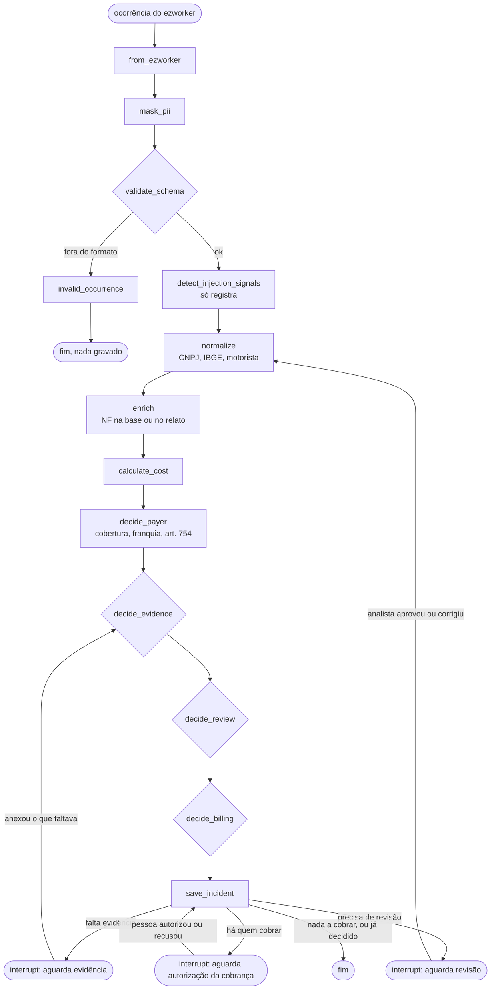

# Recupera: plano de desenvolvimento (hackathon ETEG 2026)

Toda tomada de decisão do produto acontece num grafo (LangGraph). A ocorrência chega já extraída pelo ezworker (áudio, foto e texto viram campos), e o grafo aplica regras em código: quanto custa, quem paga, até quando cobrar, se falta evidência e se uma pessoa precisa revisar. Nenhuma decisão é tomada por IA, e **nenhuma cobrança acontece sem uma pessoa autorizar**.

> Regra de ouro: **o ezworker extrai, as regras recomendam, uma pessoa autoriza.** O que vem do motorista é sempre tratado como dado.

Este documento descreve o que está construído na branch `feat/graph` (atualizado em 25/11/2026). A ordem das tarefas e o andamento estão em [ORDEM_DE_EXECUCAO.md](ORDEM_DE_EXECUCAO.md); o contrato da API, em [API.md](API.md).

---

## 0. Convenções e decisões do time

- **Código novo em inglês** (grafo, regras, consultas, tabelas novas). O código da primeira versão do app (telas, `casos`, `lib/regras.ts`, `lib/store.ts`) fica em português, como está.
- **Sem integração própria com o Claude.** Quem extrai é o ezworker; o projeto não chama nenhum modelo de IA.
- **Gravação em dois lugares:** o grafo grava em `incidents` (base dos gráficos, com o volume de entregas como denominador) e espelha o resultado em `casos`, que as telas atuais leem. Assim F2, F3 e F5 funcionam sem mudança no front.
- **Regras reescritas** em `lib/rules/`. Para as ocorrências que passam pelo grafo, a decisão do grafo substitui a de `lib/regras.ts`.

Glossário:

| Domínio (PT) | Código (EN) |
|---|---|
| ocorrência | `incident` |
| transportadora / motorista / rota / entrega | `carrier` / `driver` / `route` / `delivery` |
| nota fiscal / chave da NF-e | `invoice` / `nfe_key` |
| apólice / franquia | `insurance_policy` / `deductible` |
| quem paga: seguradora, transportadora, embarcador, absorvido | `payer`: `insurer`, `carrier`, `shipper`, `absorbed` |
| prazo para reclamar (protesto, art. 754) | `claim_deadline` |
| tipos: avaria, extravio, recusa, reentrega, divergência, acidente, atraso | `damage`, `loss`, `refusal`, `redelivery`, `discrepancy`, `accident`, `delay` |
| decisão (trilha de auditoria) | `decision` |

---

## 1. Arquitetura



| Tema | Decisão |
|---|---|
| Stack | Next.js 16 em Cloudflare Workers (OpenNext), D1 via Drizzle, R2 |
| Grafo | `@langchain/langgraph`; estado salvo no D1 por um checkpointer próprio (`lib/graph/d1-checkpointer.ts`), porque o Worker não guarda memória entre requisições |
| Validação | Zod em toda entrada e saída do grafo |
| Observabilidade | Tabela `node_runs`: tempo de cada passo de cada ocorrência, com o tempo de espera separado |

---

## 2. O grafo de decisão

O desenho abaixo é gerado do próprio código em `GET /api/graph/diagram`.



| Nó | O que faz |
|---|---|
| `from_ezworker` | Converte o JSON do ezworker para o formato interno (`lib/ai/ezworker-adapter.ts`) |
| `mask_pii` | Troca CPF, telefone, placa e e-mail por marcadores no texto livre |
| `validate_schema` | Valida com Zod; ocorrência fora do formato não vira registro |
| `detect_injection_signals` | Procura texto com cara de instrução; só registra e força revisão, nunca muda dados |
| `normalize` | Transportadora pelo CNPJ ou nome, rota pelos códigos IBGE, motorista pelo cadastro |
| `enrich` | Busca a NF na base de entregas; se não achar, usa valor e apólice do próprio relato |
| `calculate_cost` | Custo por tipo de ocorrência |
| `decide_payer` | Quem paga e prazo para reclamar |
| `decide_evidence` | Usa a lista de pendências do ezworker; sem lista, aplica a evidência mínima por tipo |
| `decide_review` | Revisão humana se confiança < 0,75, custo > R$ 10.000, sinal de ataque ou NF não encontrada |
| `decide_billing` | Se há alguém a cobrar (pagador diferente de "absorvido" e custo acima de zero), pausa para autorização, **qualquer que seja o valor** |
| `save_incident` | Revalida e grava em `incidents`, `decisions` e `casos` |
| `await_evidence` / `await_review` / `await_authorization` | Pausas; retomadas pelas ações das telas atuais ou pela API |

Cada nó de decisão grava uma linha na trilha (`decisions`): regra aplicada, o que leu, o que decidiu e o motivo em português. Ela aparece no detalhe da ocorrência como "por que o sistema decidiu isso".

**Quem decide o quê**

| Decisão | Quem |
|---|---|
| Ler o relato e preencher campos | IA, no ezworker |
| Custo, quem paga, prazo, evidência que falta, se precisa de revisão | Regras em código (recomendação) |
| Confirmar ou corrigir os dados | Pessoa, quando a revisão é exigida |
| Autorizar ou recusar a cobrança | Pessoa, sempre que houver alguém a cobrar |

O sistema ainda não envia carta nem cobrança: depois da autorização, o caso fica pronto para o envio, que é a próxima funcionalidade.

**Retomada pelas telas atuais** (`lib/graph/case-review.ts`):
- "Aprovar tratativa" (`POST /api/ocorrencias/:id`): se o grafo espera a revisão, confirma os campos como a analista deixou, refaz NF, custo e pagador e autoriza a cobrança no mesmo clique; se espera a autorização, autoriza.
- Autorizar ou recusar pela API: `POST /api/incidents/:number/authorization` (`decision`, `reviewer` e, para recusar, `reason`). A tela ainda não tem o botão de recusar.
- "Anexar evidência" (`POST /api/ocorrencias/:id/evidencias`) retoma a pausa de evidência quando não falta mais nada.
- Se o grafo falhar ao retomar, o erro vai para o log e a ação da analista segue.

---

## 3. Regras (`lib/rules/`)

Funções puras, sem banco nem grafo, cada uma com testes de tabela. Valores ajustáveis em `lib/rules/config.ts`.

**Custo** (`cost.ts`): avaria = (valor da NF + frete de retorno) × volumes afetados ÷ total; extravio = valor da NF proporcional; recusa = frete de ida e volta; reentrega = frete + taxa fixa de R$ 50; divergência = valor informado ou 10% da NF (estimado); acidente = valor da NF; atraso = sem custo direto.

**Quem paga** (`payer.ts`), na ordem:
1. Relato depois do prazo de protesto (avaria visível: dia da entrega; oculta: 10 dias) → absorvido.
2. Recusa, reentrega e atraso → transportadora.
3. Embalagem inadequada (excluída do RCTR-C) → embarcador.
4. Dano na carga/descarga sem cobertura adicional → transportadora.
5. Sem apólice ou custo dentro da franquia → transportadora.
6. Causa coberta e acima da franquia → seguradora.

**Revisão** (`review.ts`), **evidência mínima** (`evidence.ts`) e **sinais de ataque** (`injection-signals.ts`).

---

## 4. Dados

Tabelas novas (migração `0004`), ao lado das da primeira versão (`casos`, `padroes`, `mensagens_whatsapp`, `tarefas_analise`):

| Tabela | Para |
|---|---|
| `carriers`, `drivers`, `routes`, `insurance_policies` | Cadastros com identificação fixa (CNPJ, código IBGE) |
| `deliveries` | Entregas: o denominador de todo indicador |
| `incidents` | Ocorrências, com rota, transportadora e motorista normalizados e o `thread_id` do grafo |
| `decisions` | Trilha de decisões |
| `node_runs` | Tempo de cada passo (observabilidade) |
| `graph_checkpoints`, `graph_checkpoint_writes` | Estado do grafo entre pausas |
| `reviews`, `evidence`, `clusters`, `incident_clusters` | Reservadas para revisão, evidências e agrupamento de motivos |

O banco recusa tipo, status e pagador fora da lista (`CHECK`).

**Base fictícia** (`npm run db:seed:local`, determinística): 6 transportadoras, 10 rotas com códigos IBGE reais, 40 motoristas, 14.644 entregas em 9 meses, 632 ocorrências. Padrões plantados só no texto livre:
- "caixa molhada" em São Paulo → Curitiba com a Transportadora Beta (26 relatos até agosto, 3 depois de setembro);
- recusas à noite (61,9 por mil entregas, contra 2,6 de dia);
- 50 ocorrências (`PII-001` a `PII-050`) com CPF, telefone e placa, para medir o mascaramento.

---

## 5. Critérios de qualidade

Seis dos oito critérios do júri. Todos os números saem de `GET /api/quality`, que roda a bateria de ataques ao vivo.

| Critério | Como aplicamos | Como provamos |
|---|---|---|
| Saídas confiáveis (schema) | Zod na entrada (`validate_schema`) e antes de gravar; `CHECK` no banco | % de ocorrências válidas e "gravadas sem validação = 0"; teste com ocorrência fora do formato |
| Resiste a ataques | Texto do motorista é dado; decisões só leem valor, causa e apólice; sinais registrados e enviados à revisão | Bateria de 10 ataques com gêmeo limpo (`npm run quality:attacks`): custo e pagador iguais, revisão nunca pulada. Resultado: 10 de 10 |
| Controle humano | Pausa de revisão para dados duvidosos ou de valor alto; pausa de autorização para toda cobrança | % enviada à revisão, com os motivos; cobranças autorizadas, recusadas e "cobranças sem pessoa = 0" |
| Acesso mínimo | Agentes só têm a chave `READ_API_TOKEN`, que abre `/api/read/*` (só GET); servidor MCP sem acesso ao banco | 6 ferramentas, 0 de escrita; testes conferem que as rotas de leitura só têm GET e checam a chave |
| Observabilidade | `node_runs` com o tempo de cada passo, espera separada | Tempo de processamento por ocorrência (mediana e p95) e por passo |
| Dados pessoais | Mascaramento antes de gravar o texto e a trilha; leitura para agentes sem o caso original | % mascarada nos 50 relatos plantados e "vazamentos no que ficou gravado = 0" |

Fora do escopo: evals com gabarito e roteamento entre modelos (não há modelo no projeto). Limitação a declarar: placa e rosto dentro das fotos não são mascarados; isso fica com o ezworker.

---

## 6. Estrutura

```
lib/graph/        grafo, estado, checkpointer D1, portas, espelho em casos, retomada pelas telas
lib/rules/        regras puras + config.ts
lib/ai/           formato interno da ocorrência e conversão do JSON do ezworker
lib/queries/      KPIs, lista e detalhe de ocorrências
lib/quality/      bateria de ataques, medição de mascaramento, relatório de qualidade
lib/pii.ts        mascaramento de dados pessoais
lib/auth.ts       chave de leitura dos agentes
mcp/              servidor MCP e catálogo de ferramentas
scripts/          gerador da base fictícia, bateria de ataques
tests/            86 testes (regras, grafo, mascaramento, ataques, acesso)
```

---

## 7. Pendências que dependem do time

1. **Alçada e confiança mínima:** R$ 10.000 e 0,75 (o código antigo usava 0,7). A alçada agora define só a revisão dos dados; a cobrança sempre passa por autorização.
1. **Botão de recusar a cobrança** na tela (a API já existe) e **envio da carta ou da cobrança** depois da autorização.
2. **Pedido de evidência ao motorista:** hoje o grafo registra o pedido e pausa; mandar a mensagem pelo WhatsApp depende de decidir o texto e o envio.
3. **Telas:** ligar F1 aos endpoints de KPIs (hoje usa uma base fixa em memória), mostrar a trilha de decisões no F3 e criar a F7 (qualidade).
4. **Mock e gráficos:** as ocorrências do mock usam NFs que não existem na base fictícia, então entram nos totais mas não nos gráficos por rota. Ajustar o mock é decisão de quem cuida dele.
5. **Custo por ocorrência no ROI:** o gasto de IA acontece dentro do ezworker; para medir, o ezworker precisa devolver tokens ou custo no webhook.
6. **Segredos no ambiente publicado:** `READ_API_TOKEN` (`npx wrangler secret put READ_API_TOKEN`).
